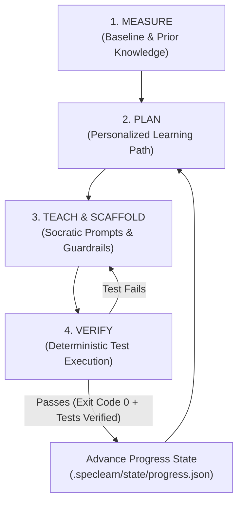
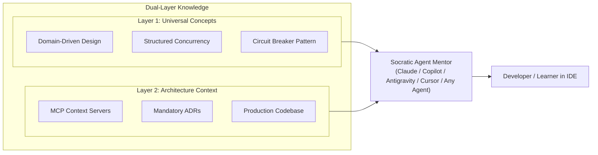

<div align="center">

# SpecLearn

**Spec-Driven Learning (SDL) for Coding Agents**  
*Turn Claude Code, GitHub Copilot, Antigravity, Cursor, and any coding agent into Socratic mentors inside your IDE.*

[](https://www.npmjs.com/package/speclearn)
[](https://github.com/hugomsm/speclearn/actions)
[](LICENSE)
[](https://nodejs.org/)

</div>

---

## The AI Engineering Paradox

AI coding agents are dramatically accelerating software development. Through **Spec-Driven Development (SDD)**, agents can take a formal specification and scaffold production-ready code in seconds.

However, this breakthrough has created the **AI Engineering Paradox**:

> **As code generation accelerates toward zero marginal cost, human architectural comprehension risks degrading.** When agents write 95% of the code, engineers become passive code reviewers who lose intuition for business rules, edge cases, and underlying domain models.

### Why Legacy Learning Approaches Fail in the Agent Era

1. **Traditional Video Courses (LMS)**: Disconnected from your real code. You watch someone else write code in a trivial playground, retaining little and struggling to apply concepts to real-world architectures.
2. **Spec-Driven Development (SDD)**: Optimizes strictly for execution throughput (*"agent, build this spec"*). It treats the human as an approving rubber stamp rather than an upskilled architect.
3. **Ad-Hoc Prompting**: Lacks deterministic ground truth. An LLM will enthusiastically praise a flawed implementation that silently breaks under concurrency or invalid state transitions.

---

## The Spec-Driven Learning (SDL) Manifesto

**Spec-Driven Learning (SDL)** transforms specifications from mere code generation templates into **executable learning curriculums**.

Under SDL:
- **Specifications Drive Mastery**: Specifications define learning outcomes, universal tech concepts, and architectural constraints.
- **Agents Act as Socratic Mentors**: Guided by Socratic mentor rules, agents challenge you with probing questions, provide conceptual hints, and refuse full-code spoilers.
- **Verification is Deterministic**: Learning progression is unlocked only when local unit, integration, and architecture tests pass exit code `0` with tamper-proof test verification.
- **Dual-Layer Context**: Learning blends universal software engineering concepts (DDD, Circuit Breakers, Monads) with your team's live architectural context (ADRs, MCP resources, and real codebases).

---

## What is a Socratic Agent?

A **Socratic Agent** is a coding agent (Claude Code, GitHub Copilot, Antigravity, Cursor, or any agent supporting the open `.agents/skills/` standard) operating under Socratic mentor rules defined by a COURSE-SPEC. Instead of acting as an autonomous code generator, it adopts the role of a **Socratic mentor** — following the same method used by Socrates: leading the learner to understanding through targeted questions, structured hints, and guided experimentation, rather than delivering answers directly.

### How it works in practice

When `harness_rules.socratic_mode: true` is set in a course spec, the agent is constrained to:

| Behavior | Standard Agent | Socratic Agent |
| :--- | :--- | :--- |
| **Implementation request** | Writes the full solution | Politely refuses full code and asks what business rules and edge cases to tackle first |
| **Pacing & turn-taking** | Dumps multi-part plans or answers | Asks exactly one focused question at a time and waits for your response |
| **When stuck** | Gives away the complete answer | Escalates hints in 3 tiers: conceptual question → architectural pointer → partial stub |
| **Wrong approach detected** | Silently fixes it or accepts it | Poses a guiding question that exposes the flaw |
| **Verification failure** | Diagnoses and patches the code | Analyzes `stdout`/`stderr` and asks exactly one diagnostic question without editing code |
| **Concept explanation** | Delivers a long lecture | Runs interactive micro-examples (≤15 lines) in `.speclearn/scratchpad/` with an understanding check |
| **Module completion** | At the developer's request | Only after deterministic test execution exits `0` with tamper-proof test verification |

### Socratic Pacing & Hint Escalation in `/slx:start`

When you begin or work through a module:
1. **One Question at a Time**: The mentor asks a single focused question and waits for your response before scaffolding further.
2. **Gradual Hint Escalation**:
   - *Tier 1 (Conceptual)*: Explores domain rules, invariants, and edge cases.
   - *Tier 2 (Architectural)*: Points to relevant contracts, function signatures, or test files.
   - *Tier 3 (Scaffolding)*: Introduces runnable `# TODO(speclearn)` stubs or failing tests—never working solutions.
3. **Refusal of Solution Spoilers**: If you ask the mentor to write the code for you, it redirects you back to the active problem so you build genuine muscle memory.

### The Socratic loop in `/slx:explain`

The `/slx:explain` command activates an isolated learning scratchpad:

1. The agent pauses the active lab and opens a minimal file strictly under `.speclearn/scratchpad/` (never touching production or target files).
2. It prompts you first—asking what you expect a pattern or construct to do—before introducing theory.
3. It demonstrates the concept through runnable micro-examples (≤15 lines), letting you experiment.
4. Before concluding, it asks a check-for-understanding question to confirm the insight, then smoothly returns you to the active lab.

### Disabling Socratic mode

Socratic mode is **enabled by default** (`socratic_mode: true`) in every course spec. Course authors can disable it for specific courses, though this is discouraged for learning-oriented courses:

```yaml
harness_rules:
  socratic_mode: false         # agent may provide full implementations
  allow_full_code_spoiler: true
```

> [!NOTE]
> Even with `socratic_mode: false`, the **verification checkpoint is never bypassed**: the agent still cannot mark a module as completed without the CLI's tamper-proof test verification check passing. The Socratic constraint governs *how* the agent teaches, not *how* completion is validated.

---

## Comparison Matrix

| Dimension | Traditional Video LMS (Coursera, Udemy) | SDD Harnesses (OpenSpec, Spec-Kit) | Spec-Driven Learning (SpecLearn) |
| :--- | :--- | :--- | :--- |
| **Primary Goal** | Passive knowledge consumption | Rapid automated code generation | Active developer mastery & mental models |
| **Human Role** | Passive spectator | Spec writer & PR reviewer | Hands-on engineer & active learner |
| **Agent Role** | None (Static pre-recorded videos) | Autonomous code generator | Socratic mentor & real-time architecture coach |
| **Feedback Loop** | Multiple-choice quizzes / None | Git diff inspection | Socratic dialogue + instant test execution |
| **Context Integration** | Isolated toy browser playground | Target codebase | **Dual-Layer**: Tech concepts + Real repo MCP/ADRs |
| **Anti-Cheat Verification** | Honor system | CI unit tests on agent output | Deterministic test runner + tamper-proof test verification |
| **Agent Tool Compatibility** | Web browser only | Terminal / agent-specific | Universal (Claude Code, GitHub Copilot, Antigravity, Cursor, and any agent via `.agents/skills/`) |

---

## Visual Architecture

### 1. The 4-Stage Pedagogical Loop

SpecLearn guides the developer through a structured cycle designed to build durable mental models:



### 2. Dual-Layer Knowledge Architecture

Courses bind high-level computer science principles with your real repository context:



---

## 30-Second Quickstart

### Step 1: Initialize SpecLearn

Run the interactive initializer in your repository:

```bash
npx speclearn init
```

Or initialize specific agent adapters non-interactively:

```bash
npx speclearn init --agents claude,copilot,antigravity,cursor,generic --yes
```

This compiles native skills and slash commands directly into your coding agent's configuration directories:
- **Claude Code**: `.claude/commands/slx/`
- **GitHub Copilot**: `.github/prompts/`
- **Cursor**: `.cursor/rules/`
- **Antigravity**: `.gemini/commands/` & `ANTIGRAVITY.md`
- **Generic / Any Coding Agent**: `.agents/skills/slx-*/` & `AGENTS.md`

The initializer also installs the versioned COURSE-SPEC JSON Schema at `.speclearn/course-spec.v1.schema.json`. The `/slx:propose` skill reads it when authoring course metadata and modules.

### Step 2: Learn with Slash Commands

Open your agent terminal or chat in your IDE and interact using the `/slx:*` (SpecLearn eXperience) commands:

```text
/slx:propose "Design an event-driven Kafka course based on our ADRs"
/slx:start domain-entities-and-aggregates
/slx:explain "Why should domain entities not reference ORM annotations?"
/slx:verify
```

---

## The `COURSE-SPEC` Open Standard

Courses are declared as either hybrid Markdown documents (`.course.md`) with YAML frontmatter or pure YAML files (`.course.yaml`).

The JSON Schema is published at `schemas/course-spec.v1.schema.json` for IDE autocomplete and schema validation.

Here is a concise example of a `.course.md` specification:

```markdown
---
schema_version: "1.0"
id: typescript-clean-architecture
title: TypeScript Clean Architecture & Hexagonal Ports
author: SpecLearn Core Authors
tier: official
level: intermediate
estimated_hours: 6
locale: en
context_sources:
  mcp_resources:
    - mcp://codebase-architecture
  mandatory_adrs:
    - docs/adr/001-hexagonal-architecture.md
harness_rules:
  socratic_mode: true
  allow_full_code_spoiler: false
  scratchpad_enabled: true
modules:
  - id: domain-entities-and-aggregates
    title: Domain Entities and Core Business Aggregates
    prerequisites: []
    universal_concepts:
      - Domain-Driven Design (DDD)
      - Aggregate Roots
      - Immutability
    arch_context:
      - Core Domain Layer Isolation
    verification:
      test_command: pnpm test tests/unit/domain
      test_files:
        - tests/unit/domain/order-aggregate.test.ts
      rubric_checks:
        - Entity enforces its own business rules without relying on external validation
        - Business rules throw domain exceptions without framework imports
---

# Tutor Guide: TypeScript Clean Architecture

Welcome! When teaching this course, the agent MUST:
1. Challenge the learner to identify the business rules and edge cases before writing constructors.
2. Refuse to write complete implementation files into the workspace.
3. Prompt the user to run `/slx:verify` when unit tests are implemented.
```

Explore our canonical examples in [`examples/`](examples/):
- [`examples/typescript-clean-architecture.course.md`](examples/typescript-clean-architecture.course.md): Hybrid Markdown course with embedded tutor guide.
- [`examples/python-async-resilience.course.yaml`](examples/python-async-resilience.course.yaml): Pure YAML course spec modeling Python 3.11+ async resilience.

---

## Delivery Modes

COURSE-SPEC supports two delivery modes via the `mode` field. Choose the one that fits how you want to learn.

### Sandbox mode (default) — isolated practice lab

The agent sets up an isolated Git branch or `.speclearn/sandbox/` directory. Your main branch stays untouched while you work through the exercises.

```yaml
mode: sandbox  # default — can be omitted
```

This is the right choice for:
- Learning a new concept without touching production code
- Running a team-shared course where each developer practices independently
- Exploring patterns before applying them to your real codebase

### Workspace mode — guided real-feature delivery

The agent guides edits **directly inside your repository's real files** while still acting as a Socratic mentor. It won't write the full implementation for you — it coaches you through building a real feature step by step, keeping the git diff PR-ready.

```yaml
mode: workspace
modules:
  - id: add-payment-domain
    title: Add the Payment Domain Layer
    target_files:
      - src/domain/payment.ts
      - src/ports/payment-gateway.ts
    verification:
      test_command: pnpm test tests/payment.test.ts
      regression_command: pnpm test   # runs your full suite after feature tests pass
      rubric_checks:
        - No leaky abstractions across the domain boundary
        - Payment entity enforces its own business rules
```

`target_files` tells the agent exactly which files in your repo belong to this module. The agent won't write outside those files. `regression_command` runs your full test suite after the module's feature tests pass — a regression failure blocks completion so you know immediately if your change broke something upstream.

### Switching modes for a single session

You can override the course's configured mode without changing the shared course file. This is useful for external or team-shared courses where you want to try a different setup:

```bash
# Start a course in workspace mode (even if the course file says sandbox)
npx speclearn start my-course.course.yaml --workspace

# Start a course in sandbox mode (even if the course file says workspace)
npx speclearn start shared-course.course.yaml --sandbox
```

The override is saved in your local `.speclearn/state/` only — it never modifies the shared course file.

---

## CLI Command Reference

SpecLearn is a deterministic, zero-LLM CLI compiler and test runner.

| Command | Description |
| :--- | :--- |
| `speclearn init` | Initialize SpecLearn configuration and agent adapters in current repo |
| `speclearn validate <path>` | Validate a `.course.md` or `.course.yaml` against COURSE-SPEC standard |
| `speclearn status` | Show current course progress bar, module tree statuses, and scores |
| `speclearn start <module-id>` | Activate a course module and initialize concept scratchpads |
| `speclearn verify [module-id]` | Run your tests and record completion with tamper-proof verification |
| `speclearn lock-tests [module-id]` | Snapshot test files so tampering is caught during verification |
| `speclearn skip <module-id>` | Skip a module and record reason in progress state |

---

## Local Development

```bash
# Clone the repository
git clone https://github.com/hugomsm/speclearn.git
cd speclearn

# Install dependencies (Node >= 24 LTS, pnpm >= 10)
pnpm install

# Run build and development watchers
pnpm dev

# Execute unit and validation tests
pnpm test

# Typecheck and lint
pnpm typecheck
pnpm lint
```

---

## License

SpecLearn is licensed under the [MIT License](LICENSE).
